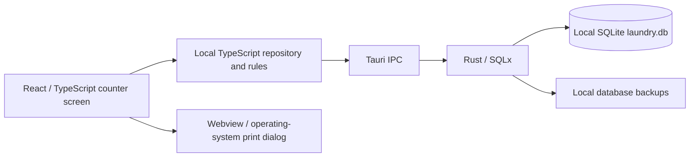

> **Status: historical.** This is the original design plan. Parts of it were changed or dropped during implementation (for example the plan expects a payment balance, while payment is now always collected in full at save, and admin-managed discounts and a second backup folder were added). It is not a description of the current app. For the current behaviour and what is and is not verified, see [DESKTOP_ACCEPTANCE.md](../DESKTOP_ACCEPTANCE.md).

# Friendly garment POS, staff access, and garment tracking plan

Date: 2026-10-15
Repository: /home/lordpatil/projects/smart-laundry-pos
Branch inspected: codex/local-first-macos
Status: Original design; implementation now delegated under the linked work packages.

> Superseded details (2026-10-15): Windows is the installation target; Linux is development. Internal tags contain no ready date, barcode or QR. Packing/pickup uses manual piece matching. See [the delegated work packages](2026-10-15-luna-work-packages.md) for current task scope and definitions of done.


## 1. Outcome and confirmed requirements

Make the installed Ubuntu/macOS desktop app simple enough for counter staff to take an order by tapping recognisable garment pictures, with very little typing.

Confirmed with the owner:
- Offer Wash, Iron, Wash + Iron, and Dry Clean. Wash + Iron is the initial selection.
- Allow different garments and services within the same order, including sarees and kurtas for dry cleaning.
- Include shoes.
- Tapping a garment picture adds one unit. Repeated taps add more. Each tile also has minus, quantity, and plus controls.
- Prices come from an administrator-maintained rate card.
- A new order is always due two calendar days after receipt, at 17:00 in Asia/Kolkata.
- Saving automatically starts a customer bill on the Canon laser printer and garment tags on the TSC TE244.
- The TSC roll is confirmed as 50 mm / 5 cm wide.
- Print one tag for each physical garment. Tags must remain identifiable throughout washing, drying, ironing, and any dry-cleaning service.
- Keep this task at the planning stage.

The application will continue to work locally without internet. A public customer bill URL is a separate possible later feature.

## 2. Current architecture and its implications

There are two distinct application paths in this repository.

### Installed desktop app — the scope of this plan



- Entry: src/desktop.tsx renders src/pages/LocalFirstApp.tsx.
- React, Tailwind, and existing UI components render the interface. Most desktop screens currently live in one large LocalFirstApp.tsx file.
- src/lib/localFirst/repository.ts performs business validation, totals, and SQL statement construction.
- src/lib/localFirst/db.ts invokes native SQL commands. Rust owns transactions and database access.
- SQLite stores customers, services, orders, quantity-based item rows, payments, order status history, expenses, inventory, machines, settings, and audit records.
- Backups and staged restore already exist. Records stay on the computer; review and normal builds use separate data directories.
- The local user schema and login support only one administrator. There is no non-admin desktop account to open.
- Services currently combine a name, category, per-piece price, and per-kg price. Garment definitions and service methods are not separate concepts.
- Counter staff can currently type item names and override line rates and discounts.
- New orders default to two days later at 23:59:59.999. Selecting a date in the form uses 18:00 instead. The receipt displays the ready date without its time.
- Saving an order does not print it. The receipt is printed separately through the OS/webview print dialog. There are no garment-instance records, garment tag templates, automatic printer routing, or durable print jobs.
- Existing native SQL validation protects transactions and schema, but does not authorize individual users or tables. Admin-only rates cannot be implemented securely by hiding UI fields alone.

### Existing browser / Android app

The web entry src/App.tsx uses Supabase, a separate account system with staff/laundry-owner roles, and existing browser/Android features. Its public receipt page reads Supabase records. These accounts and receipt links do not automatically work with the desktop SQLite database.

Recommendation: improve the desktop path for this rollout, retaining React, Tauri, Rust, and SQLite. Reuse existing components and proven order/payment logic where appropriate. Do not add cloud synchronization as a prerequisite for simple counter operation.

## 3. Proposed counter experience

### Screen layout

A dedicated New Order screen is the staff landing screen.

1. Customer strip: mobile-number search with existing-customer matches; select a match or enter a new name inline. New customers are saved with the order, without visiting another page.
2. Service strip: Wash | Iron | Wash + Iron (selected initially) | Dry Clean.
3. Garment grid: large pictures, Marathi/English names, the selected service's fixed rate and billing unit, and minus / quantity / plus below each image.
4. Persistent order summary: customer, garment/service rows, physical count, amount, payment received, balance, and the exact promised date/time.
5. One primary button: Save & Print Bill + Tags.

Notes, damage/stain information, and optional piece details are collapsed until needed. Keep business operations usable with a mouse, touchscreen, or keyboard; use large targets, visible focus, text labels, and counts rather than colour alone.

### Interaction rules

- Tapping Shirt once adds one shirt for the currently selected service; tapping again makes two.
- Plus does the same. Minus removes one, stopping at zero. Quantity can also be entered directly with whole-number validation.
- Several garment categories can be selected without closing a picker.
- Switching the service changes which rates and tile counts are shown. It preserves items already added under other services and never silently changes their treatment.
- The summary groups by garment and service. For example, three shirts for Wash + Iron, one saree for Dry Clean, and one kurta for Iron can coexist.
- Wash + Iron is one treatment choice for a physical garment; selecting it must not create duplicate Wash and Iron billing lines or duplicate physical garments.
- To change the treatment of an already-added piece, provide a clear Move to service action. Preserve physical identity where it has already been assigned.
- Only valid, configured garment/service combinations can be added. An unavailable combination is labelled, not offered at zero or at a guessed rate.
- Sarees and kurtas can expose Dry Clean when the administrator enables it; availability is explicit. Shoes never offer Iron or Wash + Iron.
- Before saving, the staff member can verify the large physical count against the clothes handed over.
- Save is guarded against double-clicks and repeated submissions.
- After saving, retain the order number and print progress. Only clear the current order after the saved result is established; print failures must not lose the saved order.

Recommended staff navigation: New Order, Orders / Pickup, Customers, and Print Issues. Put reports, rates, staff administration, inventory, machines, and settings behind admin access.

## 4. Garment catalogue and ImageGen asset plan

Start with approximately 19 broad categories:

- Shirt, T-shirt, jeans, trousers, shorts.
- Kurta/kameez, pyjama, salwar/churidar, leggings.
- Saree, blouse, petticoat/parkar, dupatta.
- Dhoti, lungi.
- Dress/frock, jacket, sweater.
- Shoes, billed by pair.

Support aliases such as saree/sari and pant/trouser, with reviewed Marathi names. Kids' shirts, trousers, and dresses can initially use the corresponding broad category. More detailed pricing variants, such as special sarees, can be added explicitly by the admin later.

Do not use an ambiguous all-in-one suit tile initially. A saree plus blouse is two physical pieces; a kurta plus salwar plus dupatta is three. Future set pricing must record its component pieces separately so the bill can charge for a set while tags and return checks count real objects.

Shoes need both a commercial quantity and physical tracking: one pair is billed once and contains two identifiable shoes. Recommend a shared pair ID and one tag per shoe, distinguishing left/right, so a separated shoe can be returned to its pair. Display clothes count and shoe pairs separately; do not describe two shoe tags as two pairs.

Use the built-in ImageGen workflow during implementation:
- Agree one visual style using a small pilot: shirt, jeans, saree, kurta, and shoes.
- Produce individual images in the same style, framing, visual size, and background treatment.
- Aim for simple, recognisable garment illustrations with clear silhouettes, suitable for small counter tiles.
- Avoid people, mannequins, logos, embedded prices, and embedded text.
- Render all Marathi/English labels and quantity controls in application code, so labels remain correct, searchable, and accessible.
- Bundle selected assets locally and provide a text fallback. The running POS never needs an image-generation API or internet.
- Keep stable asset identifiers separate from display names and rates.

Generation brief: "A single recognisable everyday [garment] commonly worn in Maharashtra, clean catalogue illustration, fully visible, centred, simple fabric detail, consistent framing and lighting, transparent background, no person, no mannequin, no text, no logos."

No assets will be generated during planning.

## 5. Staff accounts and a protected rate card

### Accounts

Add a named local Staff role alongside Admin. The admin creates staff members, sets/resets their PINs, and can deactivate accounts. Login shows staff names and a PIN keypad, with an explicit Admin entry and Switch user / Lock controls.

Staff can create orders, find customers, record permitted payments, update permitted processing statuses, identify garments, and reprint with an audit trail.

Recommended admin-only actions: change rates or catalogue availability, create staff, edit printer/shop configuration, access financial reports, stage restore, approve price exceptions/discounts, void payments, and cancel saved orders. Reprints can be allowed to staff without letting them change the underlying order or price.

### Pricing model

Separate:
- Garment catalogue: what the customer handed over.
- Service methods: what treatment it receives.
- Rate card: garment + service + billing unit + fixed amount + availability.

Store rupee amounts with precise money handling; prefer integer paise for the new rate model and convert legacy records carefully.

At save time, the native business operation resolves the applicable rate from the database, calculates totals, and stores a price snapshot plus rate reference/version. It must not trust a rate, total, role, or user ID supplied by the screen. Rate changes affect future orders; old bills and reprints retain their original prices.

If a rate changes while an unsaved order is open, refresh its quote and require the operator to review the new total before saving. Missing/inactive rates block that combination.

Move protected mutations behind authenticated native domain commands and a native-owned session. Remove or restrict generic SQL access so it cannot bypass rate, user, payment, or order permissions; scope staff reads as well. Hiding admin controls is only the presentation layer.

## 6. The ready-date rule

Use one domain rule, enforced when the order is first saved:

received local date in Asia/Kolkata + 2 calendar days, at 17:00 Asia/Kolkata.

Example: an order received on 15 October 2026, at any time that day, is promised for 17 October 2026 at 5:00 PM.

- Calendar days, including weekends and holidays.
- This is not a rolling 48-hour interval.
- No after-5-PM cutoff changes it.
- Remove routine date editing and the configurable completion-day setting from the counter flow.
- Compute the rule in one place and use it for screen, database, Canon bill, tag, and overdue checks.
- Store an unambiguous timestamp and display its shop-local date and time.
- Drafts crossing midnight use the actual receipt/save date; the summary must reflect it.
- Reprints, payments, status changes, and reopening the app do not move the promise.
- Preserve historical orders' stored ready dates during migration.
- A future exception policy requires a separate business decision; the initial plan applies the owner's "always" rule.

## 7. Individual garment identity and tag contents

A quantity-based order row is insufficient to identify each shirt. Add a persistent record for every physical piece, connected to the order and billing line.

For an order with four clothes, allocate four unique garment IDs and print four tags: 1/4, 2/4, 3/4, and 4/4. The fraction is the garment's position in the whole clothes order, not "third of four shirts" unless that is also the whole order.

Suggested tag:

```text
BILL SL-2026-00123
CLOTH 3 / 4
SAREE · DRY CLEAN
Customer: short display name
Mobile: ****1234
Ready: 17 Oct, 5 PM
[barcode or QR for this piece]
```

- Exact existing order prefix can be retained; the example is illustrative.
- Barcode/QR identifies the individual piece; its record resolves the bill and customer locally. Include a human-readable reference in case the code is damaged.
- Never encode full customer details or pretend an offline-only order has a working public web bill link.
- Use a short, stable piece identifier behind the printed fraction. Reprints reuse the same identity.
- Optional colour, stain, damage, and handling notes can be recorded per piece without requiring extra typing for every ordinary garment.
- Use a separate bag/bundle label when clothes are grouped, while retaining individual garment identity.
- Avoid silently changing saved counts and renumbering existing tags. First release treats saved piece composition as fixed; correcting it requires a controlled, audited action.
- Garments are order-specific instances; reusable lifetime garment identity is outside the first version.

Add a simple packing / pickup check: scan or enter each piece, show "3 of 4 matched", reject duplicates and wrong-order items, and block normal completion while pieces are missing. Keep full-order pickup in the first version; partial pickup requires an explicit piece-level collection flow if introduced later.

## 8. Printing design and physical acceptance

### Printer routing

Configure two destinations once in Admin settings:
- Canon laser: customer bill, initially A4 unless the actual shop setup requires another supported size.
- TSC TE244: one 50 mm-wide tag per physical garment; tag height and margins calibrated against the chosen stock.

Use independent bill and tag templates. Canon bills include garment/service quantities, fixed prices, total physical count, amount paid, balance, order reference, and the ready date and 5 PM time.

Implement a native print service with an OS adapter: first Ubuntu/CUPS, then macOS. Prefer a deterministic TSPL tag renderer and native spool submission after verifying the installed TE244 command support and print path; keep the adapter replaceable if a rendered-label route is more reliable on the actual hardware. Handle text safely and rasterize shaped Marathi text where printer fonts cannot render it correctly. Canon output can use a rendered PDF with bundled fonts.

Neither silent printing nor exact label sizing should depend on repeated webview print dialogs.

### Durable save and retry

Save the order, price snapshots, piece identities, optional initial payment, audit record, and bill/tag print requests in one database transaction. Dispatch print jobs only after the transaction commits.

Persist separate job states and attempts so the app can recover after a restart:
- Pending, submitting, submitted with OS job ID, failed, or outcome uncertain.
- Bill and tag progress displayed independently.
- A Canon failure does not trigger another set of TSC tags, or vice versa.
- Reprint a selected piece/range or the bill without making a new order, payment, or garment identity.
- Do not claim paper output merely because CUPS accepted the job.
- A crash after spool submission can leave an uncertain result. Reconcile the recorded job where possible and ask the operator to inspect output before replaying an uncertain job; do not promise exactly-once physical printing.
- Log reprints and restarts so duplicate labels can be understood.

### Tags that survive processing

The owner requires tags to stay with clothes through the whole process. Ordinary receipt output does not establish this property.

Before rollout, validate compatible laundry-rated stock, the appropriate ribbon, and an attachment method that remains with the garment without damaging it. Confirm compatibility with the actual TE244 and the shop's washing, drying, dry-cleaning, and ironing conditions. Do not assume any generic paper or synthetic label is suitable.

TSC explains that thermal-transfer durability depends on the face-stock/ribbon combination, and describes resin formulations for demanding conditions. This supports evaluating matched consumables; it does not certify a particular roll or attachment for this laundry.

Manufacturer references:
- [Thermal labels and printing methods](https://in.tscprinters.com/en/thermal-labels)
- [Thermal-transfer ribbons](https://emea.tscprinters.com/en/thermal-transfer-ribbons)
- [TSC TE-series documentation](https://fs.tscprinters.com/en/dl/4/2667) — family guidance; verify the exact TE244 model/firmware and accessories rather than assuming every family feature is present.

Physical checks must include left/right margin calibration, feed alignment, long/Marathi names, barcode scanning, several consecutive tags, paper/ribbon exhaustion, a disconnected printer, and recovery after restarting the app. Prior 50 mm test output was clipped, so successful physical output remains an explicit prerequisite.

If the Canon and TSC use different consumables, routing keeps their layouts and media settings independent. Do not assume an automatic cutter or a specific tear-off/attachment capability before checking the installed unit.

## 9. Data and code changes

Conceptual new or expanded data:
- local_users: admin/staff role, active state, credentials, audit attribution.
- garment_catalog: stable key, names/translations, image, unit, order, availability.
- service_methods: the four treatment choices.
- garment_service_rates: allowed combination, price, unit, version/effective metadata.
- order_items: garment/service references with historical labels and price snapshots.
- order_garments: stable piece ID, order/line, sequence, optional shoe-pair grouping and observations.
- garment_events: packing/processing/collection checks and identity history.
- printer_profiles: Canon/TSC destination and layout/media calibration.
- print_jobs and attempts: document type, piece scope, snapshot/revision, spool IDs, state, retries, errors.

These are proposed responsibilities, not a final schema to implement verbatim.

Current native storage uses schema version 1 with a single initialization migration and strict schema/restore checks. Add real versioned upgrade migrations, including the admin-only role constraint change. Preserve original records, order numbers, payment balances, audit history, and backups. Validate and migrate compatible older snapshots during restore; do not overwrite the initial migration and expect existing installations to upgrade automatically.

For existing orders, keep legacy item names and prices. Do not invent physical piece IDs for historical weight-only orders with no count, or automatically print legacy tags. Provide a deliberate reconciliation path if an old in-progress order needs tagging.

Refactor the desktop screen into focused modules for:
- Staff login / admin settings.
- Customer search.
- Garment grid and service selection.
- Order summary and save.
- Rate card.
- Piece tracking / packing.
- Bill and label rendering.
- Print queue status.

Keep business rules independent of React so domain tests and a fixture-based diagnostic CLI can exercise them. A CLI is useful for previewing bill/label payloads and testing isolated data; it must not bypass production permissions.

## 10. Implementation sequence

1. Foundation and migration: backup/restore compatibility, garment/service/rate data, native sessions and permission enforcement, fixed ready rule, piece identity, and print outbox.
2. Counter flow and assets: ImageGen pilot and full image set, bilingual garment tiles, service switching, customer lookup, fixed-price summary, inline customer creation, and deliberate Save & Print.
3. Canon and TSC integration: independent native adapters, bill/tag layouts, 50 mm calibration, durable progress, targeted retries, and physical consumable validation.
4. Packing and pickup: identify individual pieces, detect wrong/duplicate/missing pieces, and finish only complete orders.
5. End-to-end shop trial: both roles, existing-data upgrade, offline use, restart recovery, real Canon bill and TSC tags, and a small synthetic load through the actual cleaning process.

Each stage should be demonstrable with synthetic shop data before using live customer orders.

## 11. Acceptance examples

- A staff member can sign in directly and complete a normal repeat-customer order with picture taps and one save action.
- Tapping Shirt twice and Jeans once yields three pieces; minus on Shirt changes it to two total.
- Mixed Wash, Iron, Wash + Iron, and Dry Clean lines retain the right service, count, and admin-set rate.
- Shoes cannot receive ironing; one pair is charged once and both shoes can be matched.
- Staff cannot change rates, fabricate cheaper input prices, apply an unauthorized discount, or call an unrestricted SQL bridge to bypass permissions.
- A price update never changes an old bill. A changed unsaved quote is shown before confirmation.
- Every new order received on the 15th is due on the 17th at 17:00 IST, including late-night orders, weekend crossings, and a computer with another OS timezone.
- Four physical clothes create one saved order, one Canon bill request, and exactly four initial TSC tag requests with distinct stable piece identities.
- Reprint "piece 3" keeps the same order/piece identity and price; retrying it does not print another bill.
- Printer errors leave the order and payment intact and show precise next steps.
- Restarting after a save retains the order, counts, and job states without silently replaying uncertain physical output.
- The printed 50 mm tags are legible, aligned, scannable, and remain attached/readable after the actual cleaning process.
- Packing catches a garment belonging to another order, a duplicate scan, and a missing piece.
- Upgrading an existing installation and restoring a supported older backup preserve historical orders, payments, and customer records.

## 12. Decisions still needed before rollout

- The actual garment/service rate amounts, and which combinations the shop accepts. No example amount in the design becomes a production rate.
- Exact Canon model/queue and loaded bill size.
- TSC tag height, stock/ribbon specification, and attachment method proven through the cleaning workflow.
- Final Marathi terminology and the first image style after the pilot.
- Confirmation of the recommended two-tag shoe-pair policy before physical setup.
- Whether per-kg intake remains exposed in the new staff screen. Existing weight orders remain readable; new weight-based orders require an independent whole-piece count if individually tagged.

Public receipt links, multi-device/cloud sync, marketing notifications, highly detailed fabric variants, automatic treatment recommendations, and partial collection are later scope unless separately requested.
